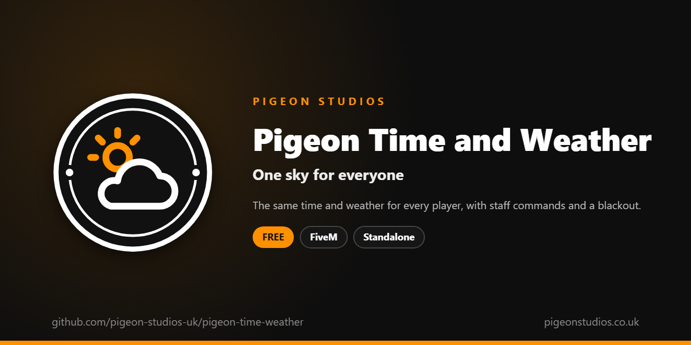

<div align="center">
  

  <h1>Pigeon Time and Weather</h1>

  <p><strong>The same time and weather for every player, changing by itself, with staff commands and a blackout, and no fighting with vMenu.</strong></p>

  <p>
    <a href="https://github.com/pigeon-studios-uk/pigeon-time-weather/releases/latest"></a>
    <a href="LICENSE.md"></a>
    <a href="https://discord.gg/2NFVWEUmDF"></a>
    
  </p>

  <p>
    <a href="https://github.com/pigeon-studios-uk/pigeon-time-weather/releases/latest"><strong>Download</strong></a> ·
    <a href="#installation">Install</a> ·
    <a href="#configuration">Configure</a> ·
    <a href="CHANGELOG.md">Changelog</a> ·
    <a href="https://discord.gg/2NFVWEUmDF">Support</a>
  </p>
</div>

---

## Contents

- [Overview](#overview)
- [Features](#features)
- [Requirements](#requirements)
- [Installation](#installation)
- [Updating](#updating)
- [Configuration](#configuration)
- [Localisation](#localisation)
- [Commands and exports](#commands-and-exports)
- [How it works](#how-it-works)
- [Update checker](#update-checker)
- [Performance](#performance)
- [Security](#security)
- [Troubleshooting](#troubleshooting)
- [FAQ](#faq)
- [Support](#support)
- [Contributing](#contributing)
- [Licence](#licence)
- [Credits](#credits)

## Overview

Pigeon Time and Weather is a free resource by [Pigeon Studios](https://pigeonstudios.co.uk) that keeps every player on the same clock and under the same sky. Without it, each player's game keeps its own time and weather, so one player is in a sunny afternoon while the player next to them is in a rainy night.

The server runs the clock and the weather, and every player's game follows. The weather changes on its own in believable steps, from clear to cloudy to rain and back. Staff can set the time and weather, stop either, and black out the city's lights. On vMenu servers that already sync with vMenu, it keeps out of the way.

## Features

- **Everyone the same.** One clock and one weather, kept by the server.
- **Weather that changes by itself.** Every 30 minutes, to a weather that makes sense next, smoothly.
- **Staff commands.** `/time`, `/weather`, `/freezetime`, `/freezeweather` and `/blackout`, by ACE permission or the console.
- **Blackout.** The city's lights go out, while vehicles keep theirs if you like.
- **Real time, if you want it.** Follow the server computer's clock instead.
- **Plays well with vMenu.** When vMenu's own time or weather sync is on, it leaves that part to vMenu.
- **For other resources.** Exports to read and set the time, weather and blackout.
- **23 languages.** Follows ox_lib's language, or set your own.
- **Standalone.** No framework or other resources needed.

## Requirements

| Requirement | Version | Notes |
|---|---|---|
| FXServer | A [recommended artifact](https://runtime.fivem.net/artifacts/) | |
| [ox_lib](https://github.com/communityox/ox_lib) | Optional | Used for the language if it's running |

**Frameworks:** none needed. It works the same on standalone and vMenu servers, ESX Legacy, QBCore, Qbox and ox_core.

## Installation

1. **Download** `pigeon-time-weather.zip` from the [latest release](https://github.com/pigeon-studios-uk/pigeon-time-weather/releases/latest). Don't use the green **Code** button; release zips are the tested builds.
2. **Extract** it into your server's `resources` folder. The folder must be called `pigeon-time-weather`.
3. **Start it** by adding this to `server.cfg`, after ox_lib if you use it:

   ```cfg
   ensure pigeon-time-weather
   ```

4. **Configure** it in `configuration/config.lua` if you want to change anything. The defaults work as they are.
5. **Restart** your server. The console shows one line from the update checker:

   ```text
   [Pigeon Studios] Pigeon Time and Weather v1.0.0 is up to date.
   ```

## Updating

1. Read the [changelog](CHANGELOG.md) for every version between yours and the latest, especially any **Upgrade notes**.
2. Back up your `configuration/` and `locales/` folders.
3. Replace the `pigeon-time-weather` folder with the new release.
4. Copy your changed settings into the new `configuration/config.lua`. Don't copy the old file over the new one; new versions can add settings.
5. Restart the resource.

## Configuration

All settings are in `configuration/config.lua`, each explained by a comment next to it.

| Setting | Default | What it does |
|---|---|---|
| `Config.Locale` | `'auto'` | The language of staff messages. `'auto'` follows ox_lib's; or a code such as `'de'` (see [Localisation](#localisation)) |
| `Config.StartHour` | `8` | The hour when the server starts |
| `Config.StartMinute` | `0` | The minute when the server starts |
| `Config.MinuteSeconds` | `2` | Real seconds in a game minute (GTA's own is 2). `0` keeps the clock still |
| `Config.RealTime` | `false` | Follow the server computer's clock instead |
| `Config.StartWeather` | `'CLEAR'` | The weather when the server starts |
| `Config.DynamicWeather` | `true` | Change the weather by itself |
| `Config.WeatherMinutes` | `30` | Real minutes between weather changes |
| `Config.Weathers` | `see the config` | Which weathers can follow each one |
| `Config.TransitionSeconds` | `30.0` | Seconds a weather change takes |
| `Config.BlackoutVehicleLights` | `true` | Leave vehicle lights on in a blackout |
| `Config.RespectVMenu` | `true` | Leave time or weather to vMenu when its sync is on |
| `Config.Permissions` | `pigeon.timeweather, command` | ACE permissions that can use the staff commands |
| `Config.Commands` | `time, weather…` | The command names |

## Localisation

Pigeon Time and Weather comes in 23 languages: `en` English, `cs` Czech, `da` Danish, `de` German, `es` Spanish, `et` Estonian, `fi` Finnish, `fr` French, `hr` Croatian, `hu` Hungarian, `id` Indonesian, `it` Italian, `nl` Dutch, `no` Norwegian, `pl` Polish, `pt` Portuguese, `pt-br` Brazilian Portuguese, `ro` Romanian, `sl` Slovenian, `sv` Swedish, `tr` Turkish, `zh-cn` Simplified Chinese and `zh-tw` Traditional Chinese. They're the languages ox_lib ships, so your server may already have one set.

With `Config.Locale = 'auto'` (the default), it uses ox_lib's language, so one line in `server.cfg` sets it for this and every other resource that follows ox_lib:

```cfg
setr ox:locale "de"
```

Use `setr`, not `set`, so players' games get it too. Without it, or for a language that isn't in `locales/`, the text is English. To choose a language for this resource only, set `Config.Locale` to its code, such as `'fr'` or `'pt-br'`.

Only staff see text, in chat or the server console, in the server's language. Chinese text can show as blank in GTA's own text, such as its notifications, because GTA only loads its Chinese font when the game itself is set to Chinese. ox_lib's notifications show every language.

Every file was checked for missing text and placeholders, but not every translation has been read by a native speaker yet. If something reads wrong, please send a fix; see [Contributing](#contributing). To add a language, copy `locales/en.lua` to a new file named with the language's code (such as `ja.lua`), change `Locales.en` at the top to match (`Locales.ja`), and translate the text in quotes.

## Commands and exports

### Commands

Staff with one of `Config.Permissions` can use these, and so can the server console:

| Command | What it does |
|---|---|
| `/time <hours> [minutes]` | Set the time: `/time 14 30` |
| `/weather <name>` | Change the weather: `/weather rain`. With no name, lists them |
| `/freezetime` | Stop the clock, or start it again |
| `/freezeweather` | Stop the weather changing by itself, or let it again |
| `/blackout` | Turn the city's lights off, or on again |

Weather names are GTA's own: `extrasunny`, `clear`, `clouds`, `overcast`, `rain`, `clearing`, `thunder`, `smog`, `foggy`, `xmas`, `snow`, `snowlight`, `blizzard`, `halloween`, `neutral`, `rain_halloween` and `snow_halloween`.

`pigeon.timeweather` can be given to any group; admins on most servers already have `command`:

```cfg
add_ace group.moderator pigeon.timeweather allow
```

### Exports

Server exports, for other resources:

```lua
local hour, minute = exports['pigeon-time-weather']:GetTime()
exports['pigeon-time-weather']:SetTime(22, 0)              -- false if the time isn't valid

local weather = exports['pigeon-time-weather']:GetWeather()  -- such as 'CLEAR'
exports['pigeon-time-weather']:SetWeather('THUNDER')        -- false if the name isn't valid

exports['pigeon-time-weather']:SetBlackout(true)
```

### State

The server shares its state in `GlobalState`, which any resource can read:

```lua
GlobalState.pigeonClock    -- { hour = 14, minute = 30, frozen = false }
GlobalState.pigeonWeather  -- { weather = 'RAIN', blackout = false, frozen = false }
```

## How it works

The server keeps the clock: it adds a game minute every `Config.MinuteSeconds` real seconds (or follows the computer's clock with `Config.RealTime`), and shares it in `GlobalState.pigeonClock`. Every player's game sets its clock to match once a second, with `NetworkOverrideClockTime`.

The server also keeps the weather. With `Config.DynamicWeather`, every `Config.WeatherMinutes` it picks the next weather from `Config.Weathers`, so weather moves in believable steps (clear, clouds, overcast, rain, clearing). Players' games change to it over `Config.TransitionSeconds`; players who join get it straight away. Snowy weathers leave tracks in the snow, and a blackout turns off the city's lights with `SetArtificialLightsState`. If another resource or a cutscene changes the weather, players' games put it back within a second.

When vMenu is running with `vmenu_enable_time_sync` or `vmenu_enable_weather_sync` on, the server marks that part as vMenu's, says so once in the console, and players' games leave it alone. The other part still works, so you can use vMenu's weather with this resource's time, or the other way round.

## Update checker

When it starts, Pigeon Time and Weather checks our public [version registry](https://github.com/pigeon-studios-uk/pigeon-versions) once and prints one line in the server console saying whether it's up to date. If there's an update, it shows what's new and where to get it. The check is a single request to GitHub and sends nothing about your server or players.

Control it for every Pigeon Studios resource at once in `server.cfg`:

```cfg
set pigeon_update_check "on"      # default: one line per resource
set pigeon_update_check "quiet"   # only when there's an update or a problem
set pigeon_update_check "off"     # never check
```

## Performance

The server updates a shared value once a game minute and checks the weather timer twice a second. Players' games set the clock once a second and only touch the weather when it changes. Neither costs anything noticeable.

## Security

- Only staff with one of `Config.Permissions`, and the server console, can use the commands; the server checks each time.
- The state is set only by the server, so players can't change anyone's time or weather.
- The only network request is the update check at start-up, from the server to GitHub. It sends nothing about your server or players.

Found a problem? Please don't open a public issue. Use the **Report a vulnerability** button in this repository's **Security** tab, or follow our [Security Policy](https://github.com/pigeon-studios-uk/.github/blob/main/SECURITY.md).

## Troubleshooting

**The time or weather keeps jumping.**
Another resource is setting them too, such as vMenu with its sync on and `Config.RespectVMenu = false`, or another weather resource. Use one of them.

**Staff commands say I don't have permission.**
Give the group `pigeon.timeweather`, or check they have `command`: in the console, `test_ace player.<id> command`.

**It's always day or night.**
Check `Config.MinuteSeconds` isn't `0` and nobody has used `/freezetime`. Use `/freezetime` again to start the clock.

**vMenu's weather menu does nothing.**
That menu sets vMenu's synced weather. With vMenu's weather sync off, this resource controls the weather instead; use `/weather`.

**The text is in the wrong language.**
Check `setr ox:locale` in `server.cfg` (with `setr`, not `set`), or set `Config.Locale` to the language's code.

**The console says "isn't in the version registry" or "couldn't check for updates".**
Your server couldn't reach GitHub, or the check is blocked by a firewall. The resource works normally either way. Turn the check off with `set pigeon_update_check "off"`.

## FAQ

**Is it really free?**
Yes. Use it on as many servers as you like, including ones that take donations. You just can't reupload, resell or bundle it. See [Licence](#licence).

**Does it work on standalone and vMenu servers?**
Yes. It needs no framework at all, and works alongside vMenu.

**Does it work on vMenu servers?**
Yes, and it's made for them. If vMenu's own sync is on for time or weather, that part is left to vMenu; otherwise this resource does it.

**Can I have only sunny weather?**
Yes. Set `Config.StartWeather = 'EXTRASUNNY'` and `Config.DynamicWeather = false`, or make every list in `Config.Weathers` only sunny weathers.

**Can I have snow at Christmas?**
Use `/weather xmas`. Snow leaves tracks and trails while it's on.

## Support

Read [Troubleshooting](#troubleshooting) first, then ask in the support channels of our [Discord](https://discord.gg/2NFVWEUmDF). Please include your Pigeon Time and Weather version, FXServer artifact and any errors from the console (F8 in game). See [Getting help](https://github.com/pigeon-studios-uk/.github/blob/main/SUPPORT.md).

Found a bug? Open a [bug report](https://github.com/pigeon-studios-uk/pigeon-time-weather/issues/new/choose).

## Contributing

Fixes, improvements and translations are welcome. Please read the [contributing guide](https://github.com/pigeon-studios-uk/.github/blob/main/CONTRIBUTING.md) first, and open a feature request before working on anything big.

## Licence

Pigeon Time and Weather is free to use under the **[Pigeon Studios Free Licence](LICENSE.md)**.

- ✅ Use it on any number of servers, including monetised ones
- ✅ Change it for your own servers
- ✅ Show it in videos and streams
- ❌ Don't reupload, share or mirror the files; link to this repository instead
- ❌ Don't sell it, bundle it in packs, or put it behind escrow
- ❌ Don't remove the credits

This summary isn't the licence; [LICENSE.md](LICENSE.md) is. Third-party components are listed in [NOTICE.md](NOTICE.md).

## Credits

Made by [Pigeon Studios](https://pigeonstudios.co.uk). Thanks to everyone who has contributed fixes and translations; see the [changelog](CHANGELOG.md).

<sub>Not affiliated with or endorsed by Rockstar Games, Take-Two Interactive or Cfx.re.</sub>
